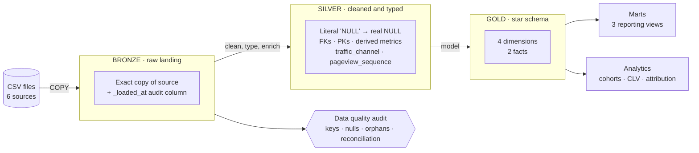
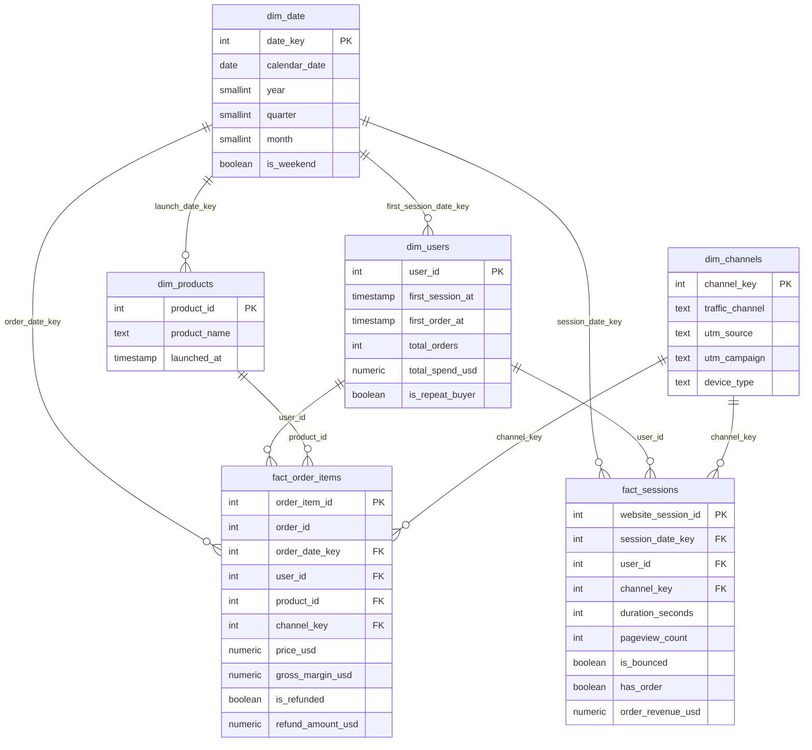

# Postgres Retail Data Warehouse

An end-to-end e-commerce data warehouse built in **PostgreSQL** using a **Medallion architecture (Bronze → Silver → Gold)**. The project turns six raw CSV exports from an online toy store into a clean star schema, reporting marts, and portfolio-grade analytics for **cohort retention, customer lifetime value (CLV), and first-touch marketing attribution**, all in pure SQL.


---

## Table of Contents

1. [Project Overview](#project-overview)
2. [Dataset](#dataset)
3. [Architecture](#architecture)
4. [Repository Structure](#repository-structure)
5. [Quick Start](#quick-start)
6. [Layer-by-Layer Walkthrough](#layer-by-layer-walkthrough)
   - [Bronze: raw landing](#bronze-raw-landing)
   - [Data quality audit](#data-quality-audit)
   - [Silver: cleaned and typed](#silver-cleaned-and-typed)
   - [Gold: star schema](#gold-star-schema)
   - [Gold: reporting marts](#gold-reporting-marts)
7. [Business Insights](#business-insights)
8. [Reconciliation Results](#reconciliation-results)
9. [Design Decisions](#design-decisions)
10. [Known Limitations and Next Steps](#known-limitations-and-next-steps)
11. [Skills Demonstrated](#skills-demonstrated)

---

## Project Overview

| | |
|---|---|
| **Goal** | Build a production-style analytics warehouse from raw e-commerce data, with every layer validated and reproducible |
| **Database** | PostgreSQL (developed and tested on 16) |
| **Database name** | `toy_shop` |
| **Pipeline runtime** | ~40 seconds end to end on a laptop-class machine (≈1.7M source rows) |
| **Re-runnable** | Yes. The runner script is idempotent (truncate and reload) |

**Business questions the warehouse answers**

- Which products earn the most net revenue, and which have the highest refund rates?
- Which marketing channels and devices convert best, and which bounce the most?
- What share of first-time buyers come back in later months (cohort retention)?
- How concentrated is revenue among top customers (CLV deciles)?
- Which acquisition channels bring in users who actually buy?

---

## Dataset

The project uses the **Maven Fuzzy Factory** dataset (Maven Analytics), a simulated online store selling plush toys. Data spans **19 March 2012 to 19 March 2015**.

| Source file | Rows | Description |
|---|---:|---|
| `website_sessions.csv` | 472,871 | One row per visit: UTM source, campaign, content, device, referrer |
| `website_pageviews.csv` | 1,188,124 | Clickstream: one row per page viewed |
| `orders.csv` | 32,313 | Order headers: user, session, primary product, price, COGS |
| `order_items.csv` | 40,025 | Order line items |
| `order_item_refunds.csv` | 1,731 | Refunds issued against line items |
| `products.csv` | 4 | Product catalog |

The raw CSVs are provided in `retail_raw_data.zip`.

---

## Architecture



| Layer | Schema | Purpose | Key traits |
|---|---|---|---|
| **Bronze** | `bronze` | Land raw data as-is | No transformation, permissive types, `_loaded_at` lineage column |
| **Silver** | `silver` | Clean and conform | Enforced PK/FK constraints, `NOT NULL`, typed columns, derived metrics |
| **Gold** | `gold` | Serve analytics | Star schema with surrogate and date keys, pre-aggregated mart views |

---

## Repository Structure

```
.
├── README.md
├── data/                              # unzip the raw CSVs here (see Quick Start)
│   ├── products.csv
│   ├── orders.csv
│   ├── order_items.csv
│   ├── order_item_refunds.csv
│   ├── website_sessions.csv
│   └── website_pageviews.csv
├── retail_raw_data.zip                # original source files
├── 01_bronze_pipeline.sql             # bronze DDL + ingestion + row-count check
├── 02_silver_transformation.sql       # bronze → silver cleaning and typing
├── 02_bronze_data_quality_audit.sql   # profiling + remediation runbooks
├── 03_gold_star_schema.sql            # dimensions, facts, reconciliation checks
├── 04_gold_marts.sql                  # reporting views + sample queries
├── 05_business_insights.sql           # cohort retention, CLV deciles, attribution
└── 06_run_full_pipeline.sql           # one-command idempotent runner (bronze → marts)
```

> **Note on ordering:** the audit script is numbered `02` because it profiles the bronze layer, but its pageview orphan check joins `silver.website_sessions`, so **run it after the silver build**.

---

## Quick Start

### Prerequisites

- PostgreSQL 13+ (tested on 16) with the `psql` client
- ~1 GB free disk space

### 1. Create the database

```bash
createdb toy_shop
```

### 2. Prepare the data

```bash
unzip retail_raw_data.zip
mkdir -p data
mv "Maven+Fuzzy+Factory"/*.csv data/
```

### 3. Run the full pipeline (recommended)

Run from the **repository root** so the relative `data/` paths resolve:

```bash
psql -d toy_shop -f 06_run_full_pipeline.sql
```

The runner uses client-side `\copy`, so the CSVs do not need to be readable by the database server. It stops on the first error (`ON_ERROR_STOP`) and prints start and end timestamps.

### 4. Run the data quality audit

```bash
psql -d toy_shop -f 02_bronze_data_quality_audit.sql
```

### 5. Explore the results

```bash
psql -d toy_shop -f 04_gold_marts.sql          # reporting views + sample queries
psql -d toy_shop -f 05_business_insights.sql   # cohorts, CLV, attribution
```

### Step-by-step alternative

To inspect each layer separately, run the scripts in this order:

```bash
psql -d toy_shop -f 01_bronze_pipeline.sql
psql -d toy_shop -f 02_silver_transformation.sql
psql -d toy_shop -f 02_bronze_data_quality_audit.sql
psql -d toy_shop -f 03_gold_star_schema.sql
psql -d toy_shop -f 04_gold_marts.sql
psql -d toy_shop -f 05_business_insights.sql
```

> `01_bronze_pipeline.sql` uses server-side `COPY` with absolute `/data/...` paths (edit them to match your environment). The runner (`06`) uses `\copy` with relative paths and is the easier option.

---

## Layer-by-Layer Walkthrough

### Bronze: raw landing

`01_bronze_pipeline.sql`

- Creates six landing tables that mirror the CSV structure, with permissive types.
- Adds a `_loaded_at` timestamp (`clock_timestamp()`) to every table for lineage and for choosing the latest record when deduplicating.
- Truncates and reloads for idempotency, then runs a row-count validation across all tables.

### Data quality audit

`02_bronze_data_quality_audit.sql`

A profiling script where **every check has a remediation runbook**: the exact SQL pattern to apply if the check fails in future loads.

| Area | Checks | Remediation pattern |
|---|---|---|
| **Primary keys** | Duplicate keys across all 6 tables | `row_number()` window dedupe on `_loaded_at desc` |
| **Sessions** | Null PKs, invalid repeat flag, literal `'NULL'` strings in UTM and referer columns | `nullif(trim(col), 'NULL')`, drop null PKs |
| **Products** | Null IDs, empty names | Reject to error table / `coalesce(..., 'unknown_product')` |
| **Orders** | Orphaned sessions and products, non-positive or null price and COGS | Quarantine table, fallback dimension row |
| **Order items** | Orphans, invalid primary flag, **header-to-line-item reconciliation** (item count, price, COGS) | Treat line-item grain as source of truth and re-aggregate headers |
| **Refunds** | Non-positive amounts, orphaned items, refunds exceeding item price | Filter, quarantine, or cap with `least()` |
| **Pageviews** | Orphaned clickstream, empty URLs, traffic share by URL | Filter to valid sessions, `'/unknown_page'` default |

**Findings on this dataset**

- ✅ No duplicate primary keys in any table
- ✅ Zero order-header vs line-item mismatches (item count, price, COGS)
- ✅ No orphaned orders, line items, refunds, or pageviews
- ✅ No refunds exceeding the original item price
- ⚠️ Missing UTM values are stored as the **literal string `'NULL'`** (83,328 sessions with a `'NULL'` `utm_source`, 39,917 with a `'NULL'` `http_referer`), which silver converts to real `NULL`s

### Silver: cleaned and typed

`02_silver_transformation.sql`

| Table | Cleaning and enrichment |
|---|---|
| `silver.website_sessions` | `'NULL'` strings → `NULL`; text trimmed; **derived `traffic_channel`** |
| `silver.products` | Names trimmed |
| `silver.orders` | Strict types; derived `gross_margin_usd` and `margin_rate` |
| `silver.order_items` | `is_primary_item` int → boolean; derived `gross_margin_usd` |
| `silver.order_item_refunds` | Strict numeric typing and FK to line items |
| `silver.website_pageviews` | URL trimmed; derived `pageview_sequence` (position within session) |

**Traffic channel classification** (first matching rule wins):

| Rule | Channel |
|---|---|
| No UTM source **and** no referer | `direct_type_in` |
| No UTM source but has referer | `organic_search` |
| `utm_campaign = 'brand'` | `paid_brand` |
| `utm_campaign = 'nonbrand'` | `paid_nonbrand` |
| `utm_source = 'socialbook'` | `paid_social` |
| Anything else | `other` |

Silver also adds primary keys, foreign keys, `NOT NULL` constraints, and indexes on join columns, so bad data fails loudly instead of flowing downstream.

### Gold: star schema

`03_gold_star_schema.sql`



**Dimensions**

| Table | Grain | Notes |
|---|---|---|
| `gold.dim_date` | One row per calendar day (2012–2015, 1,461 rows) | Generated with `generate_series`; integer `YYYYMMDD` key; weekend flag |
| `gold.dim_products` | One row per catalog product | Launch date key to `dim_date` |
| `gold.dim_channels` | One row per channel / campaign / content / device combination (15 rows) | Identity surrogate key |
| `gold.dim_users` | One row per user (394,318) | First session and first order timestamps, lifetime orders and spend, repeat-buyer flag |

**Facts**

| Table | Grain | Highlights |
|---|---|---|
| `gold.fact_order_items` | One row per purchased line item (40,025) | Price, COGS, margin, refund flag, amount and timestamp |
| `gold.fact_sessions` | One row per website session (472,871) | Duration, pageview count, bounce flag, conversion flag, order revenue |

**Engineering notes**

- Channel surrogate keys are resolved with `IS NOT DISTINCT FROM`, so `NULL` UTM values join correctly.
- `fact_sessions` is built through **indexed temporary staging tables** (pageview metrics and channel map) to avoid a slow multi-way join on 1.2M pageviews.
- Refunds are flattened onto the line-item fact (`is_refunded`, `refund_amount_usd`, `refunded_at`), which keeps net revenue a one-table calculation.

### Gold: reporting marts

`04_gold_marts.sql`: pre-aggregated views ready for BI tools.

| View | Grain | Purpose |
|---|---|---|
| `gold.mart_channel_performance` | Channel × campaign × device | Sessions, bounce rate, conversion rate, revenue, revenue per session |
| `gold.mart_product_performance` | Product | Units, gross / net revenue, margin, refund rate |
| `gold.mart_monthly_business_summary` | Year × month | Traffic, orders, conversion, gross / net revenue, gross profit |

---

## Business Insights

`05_business_insights.sql` contains three advanced analyses. Figures below come from running the pipeline on the full dataset.

### Headline numbers

| Metric | Value |
|---|---:|
| Gross revenue | **$1,938,509.75** |
| Refunds | $85,338.69 |
| Net revenue | **$1,853,171.06** |
| Gross margin | $1,216,139.50 |
| Orders / line items | 32,313 / 40,025 |
| Sessions | 472,871 |
| Session → order conversion | 6.83% |
| Bounce rate (single-pageview sessions) | 44.76% |

### Product performance

| Product | Units | Net revenue | Margin | Refund rate |
|---|---:|---:|---:|---:|
| The Original Mr. Fuzzy | 24,226 | $1,149,220 | 61.0% | 5.11% |
| The Forever Love Bear | 5,796 | $339,963 | 62.5% | 2.23% |
| The Birthday Sugar Panda | 4,985 | $215,417 | 68.5% | 6.04% |
| The Hudson River Mini Bear | 5,018 | $148,570 | 68.4% | 1.28% |

The flagship product drives about 62% of net revenue, while the two newer products carry higher margins. The Birthday Sugar Panda has the highest refund rate and the Hudson River Mini Bear the lowest.

### Channel performance

| Channel | Sessions | Orders | Conversion | Revenue |
|---|---:|---:|---:|---:|
| Paid non-brand | 337,615 | 22,640 | 6.71% | $1,349,978 |
| Organic search | 43,411 | 3,262 | 7.51% | $196,809 |
| Paid brand | 41,243 | 3,212 | 7.79% | $194,840 |
| Direct / type-in | 39,917 | 2,856 | 7.15% | $174,624 |
| Paid social | 10,685 | 343 | **3.21%** | $22,259 |

Paid non-brand supplies about 70% of revenue. Paid social converts at less than half the rate of every other channel.

### Query 1: Monthly cohort retention

Groups buyers by the month of their **first order** and tracks the share who order again in months 0 to 12. Month 0 is 100% by definition. For the January 2014 cohort (962 buyers), only **1.04%** order again in month 1 and **0.62%** in month 2.

Combined with `dim_users`, only about **1.9%** of buyers (591 of 31,696) have ever placed a second order, which makes retention the largest opportunity in this dataset.

### Query 2: Customer lifetime value deciles

Uses `ntile(10)` to rank buyers by lifetime net spend and shows each decile's customer count, spend range, margin, and **share of total revenue**.

| Decile | Customers | Share of net revenue |
|---:|---:|---:|
| 1 (top) | 3,170 | 18.03% |
| 2 | 3,170 | 14.17% |
| 3 | 3,170 | 11.28% |
| 4 | 3,170 | 9.45% |
| 5–9 | ~3,170 each | 8.42–8.55% |
| 10 (bottom) | 3,169 | 4.46% |

Revenue is spread fairly evenly: the top 10% of buyers contribute about 18%, and the top 30% contribute about 43%. With so few repeat buyers, the deciles mostly reflect single-order basket size rather than loyalty.

### Query 3: First-touch marketing attribution

Assigns each user to the channel of their **earliest session** (`DISTINCT ON`) and measures how many acquired users go on to buy, how many repeat, and the net revenue attributed.

| First-touch channel | Users acquired | Became buyers | Conversion |
|---|---:|---:|---:|
| Paid non-brand | 337,615 | 27,334 | 8.10% |
| Organic search | 16,299 | 1,371 | 8.41% |
| Paid brand | 15,019 | 1,272 | 8.47% |
| Direct / type-in | 14,700 | 1,193 | 8.12% |
| Paid social | 10,685 | 526 | **4.92%** |

---

## Reconciliation Results

Totals tie out across all three layers on this dataset:

| Check | Result |
|---|---|
| Bronze vs silver row counts | Identical for all six tables |
| Orders: header totals vs sum of line items | 0 mismatches (items, price, COGS) |
| `gold.fact_sessions` vs `silver.website_sessions` | 472,871 = 472,871 |
| `gold.fact_order_items` gross revenue vs `silver.orders` | $1,938,509.75 on both sides |
| `gold.fact_sessions.order_revenue_usd` vs fact_order_items gross | Equal ($1,938,509.75) |
| Orphaned keys (orders, items, refunds, pageviews) | 0 |

---

## Design Decisions

- **Medallion layering:** each layer has one job. Bronze preserves raw truth, silver enforces correctness, gold serves analytics.
- **Audit-first mindset:** every data quality check is paired with a documented fix, so the audit doubles as an operations runbook.
- **Line-item grain is the source of truth:** order headers are validated against line items, not the other way round.
- **Surrogate keys only where needed:** channel gets an identity key (a composite natural key is awkward), while date, product, and user keep meaningful integer keys.
- **Null-safe joins:** `IS NOT DISTINCT FROM` avoids silently dropping sessions with no UTM data.
- **Idempotent runner:** truncate-and-reload makes the pipeline safe to re-run during development.
- **Staging for performance:** temp tables with indexes keep the session fact build fast.

---

## Known Limitations and Next Steps

- **Full refresh only.** The pipeline reloads everything. An incremental load keyed on `_loaded_at` or `created_at` would suit larger volumes.
- **Dimensions are Type 1.** `dim_users` totals are snapshot values with no history. An SCD Type 2 approach would preserve change over time.
- **Quarantine tables are documented, not built.** The audit runbooks describe quarantine and fallback patterns, but this dataset is clean, so they are not wired into silver.
- **Possible extensions:** automated tests (e.g. dbt or pgTAP), orchestration (Airflow or cron), a BI dashboard on the marts, and a funnel analysis using `pageview_sequence`.

---

## Skills Demonstrated

**Data engineering:** medallion architecture · idempotent ETL · dimensional modeling (star schema, conformed dimensions, surrogate keys) · data quality profiling and remediation · performance tuning with staging tables and indexes · constraint-driven integrity

**Advanced SQL:** CTEs · window functions (`row_number`, `ntile`, running totals) · `DISTINCT ON` · `FILTER` aggregates · `generate_series` · null-safe joins · date arithmetic with `age()` and `date_trunc()`

**Analytics:** cohort retention · customer lifetime value segmentation · marketing attribution · conversion, bounce, and refund analysis

---

## Data Source

Dataset: *Maven Fuzzy Factory*, provided by [Maven Analytics](https://www.mavenanalytics.io/data-playground). Please refer to the source for its terms of use.
